# Murmur — Architecture

> **Audience:** developers working on Murmur (new contributors and future-you).
> **Scope:** how the app is put together, how a dictation flows end to end, and why it is built this way.
> **Source of truth:** the code in `Sources/`. File and symbol names below are real; if you rename one, update this doc.
> Diagrams are [Mermaid](https://mermaid.js.org) — they render on GitHub, in VS Code (Markdown Preview Mermaid Support) and in most Markdown viewers.

---

## 1. What Murmur is

Murmur is a macOS **menu-bar dictation app**. You trigger it, speak, and the cleaned-up text is pasted into whatever app has focus.

| Property | Value |
|---|---|
| Language / UI | Swift 5 mode, AppKit, no storyboard, no Xcode project, no SwiftPM |
| Platform | macOS 26+, Apple Silicon (`-target arm64-apple-macosx26.0`) |
| Speech-to-text | `SpeechAnalyzer` / `SpeechTranscriber`, **on-device** |
| Text cleanup | Apple Intelligence (`FoundationModels`), **on-device**, with a regex fallback |
| Privacy | Audio never leaves the Mac; no telemetry. The only network request is the user-initiated *Check for Updates…* |
| Presence | `LSUIElement` — menu-bar icon only, no Dock icon |

**Three ways to start dictating**

1. **Hold** the trigger key (default Right ⌥) — push-to-talk, release to finish.
2. **Double-tap** the trigger key, or press **⌃Space**, or say **"Hey Murmur"** — *hands-free* ("latched") mode; ends on a tap, ⌃Space, or ~2.5 s of silence.
3. **Menu** → *Start Dictation*.

---

## 2. System context

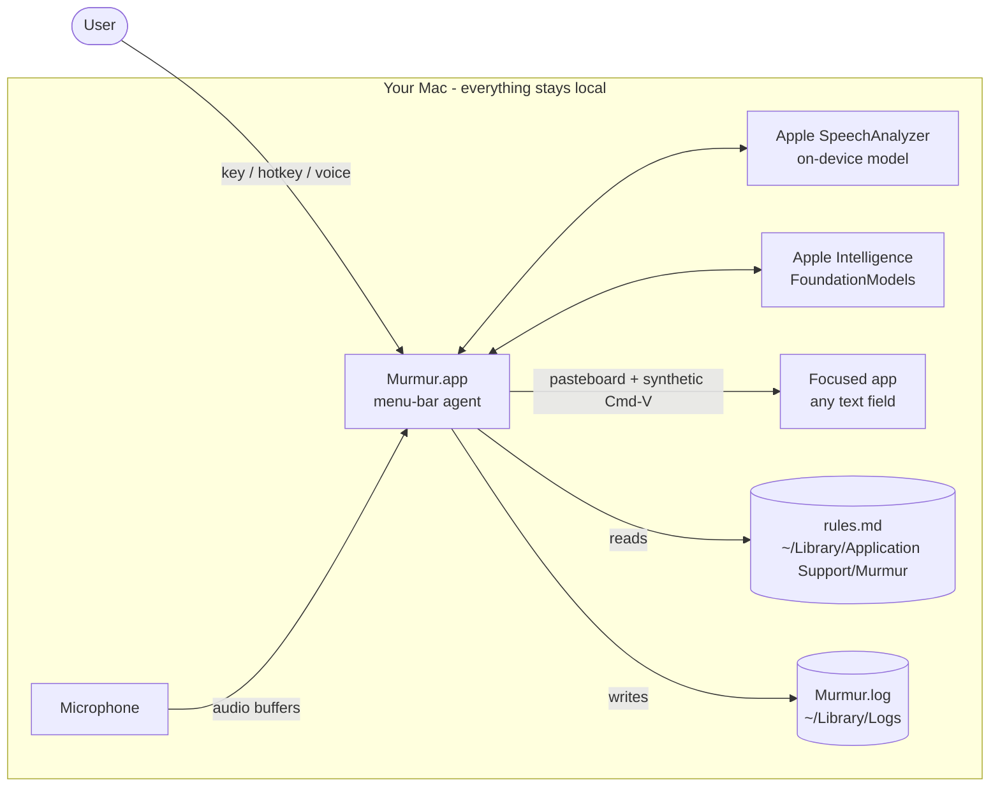

---

## 3. Component map

`AppDelegate` is the only coordinator. Every other type is a focused helper that knows nothing about the others; they communicate through closures that `AppDelegate` wires up in `applicationDidFinishLaunching`.

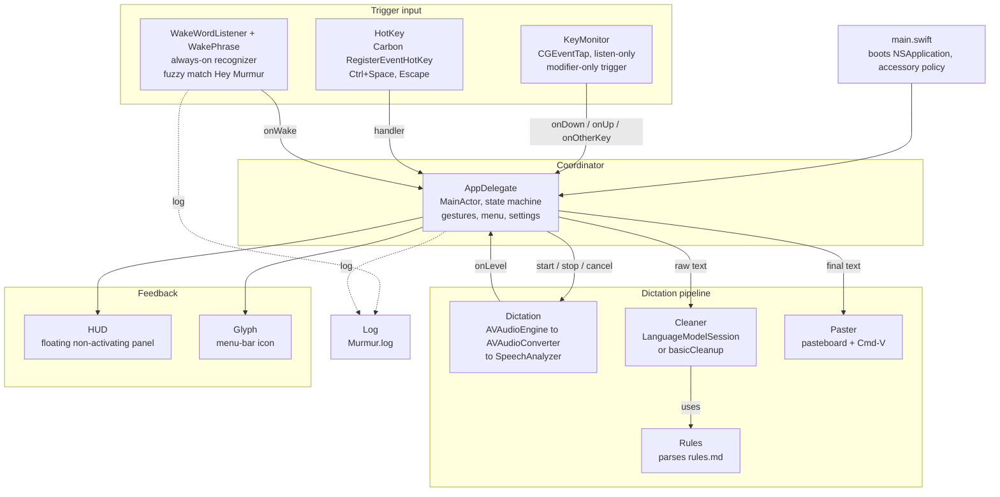

### Responsibilities at a glance

| File | Type | Owns | Notes |
|---|---|---|---|
| `main.swift` | — | App bootstrap | Sets `.accessory` activation policy, installs `AppDelegate`. |
| `AppDelegate.swift` | `AppDelegate` | State machine, gesture logic, settings, status-bar menu | `@MainActor`. Menu is rebuilt from scratch on every open (`menuNeedsUpdate`). |
| `KeyMonitor.swift` | `KeyMonitor`, `TriggerKey` | Modifier-only trigger detection | Listen-only `CGEventTap`; needs **Input Monitoring**. Re-enables itself if macOS disables the tap. |
| `HotKey.swift` | `HotKey` | Global key combos | Carbon `RegisterEventHotKey`; no permission, swallows the combo. `init?` returns `nil` if the combo is taken. |
| `Dictation.swift` | `Dictation` | Mic capture + transcription | Per-utterance `start()/stop()/cancel()`; one-time `prepare()`. |
| `WakeWord.swift` | `WakeWordListener`, `WakePhrase` | Hands-free activation | Separate recognizer session recycled every 120 s. |
| `Cleaner.swift` | `Cleaner`, `withTimeout` | Transcript polishing | 20 s timeout, length sanity check, regex fallback. |
| `Rules.swift` | `Rules` | User rules file | Parses instructions + literal replacements. |
| `Paster.swift` | `Paster` | Text insertion | Pasteboard swap, synthetic ⌘V, clipboard restore. |
| `HUD.swift` | `HUD`, `BarsView` | On-screen status pill | Never takes focus. |
| `Glyph.swift` | `Glyph` | Menu-bar icon drawing | Switches image while recording. |
| `Log.swift` | `Log` | Diagnostics | Appends to `~/Library/Logs/Murmur.log`; rotates at ~512 KB; wake-word speech is logged only in verbose mode. |
| `SilenceDetector.swift` | `SilenceDetector` | Hands-free auto-stop decisions | Pure logic with the clock passed in; unit-tested. |
| `SpokenFormatting.swift` | `SpokenFormatting` | "new line" / "new paragraph" | Applied to the cleaned text. |
| `History.swift` | `History`, `HistoryEntry` | Optional local dictation history | JSON Lines, mode 0600, newest 200; off by default. |
| `Permissions.swift` | `Permissions` | Live permission status + Settings deep links | Used by the setup window and diagnostics. |
| `SetupWindow.swift` | `SetupWindowController` | First-run / "Setup & Permissions…" window | Refreshes every second. |
| `SettingsWindow.swift` | `SettingsWindowController` | Settings window | Drives `AppDelegate` properties and actions. |
| `Updater.swift` | `Updater` | Version compare, GitHub latest-release check | Network only on user click. |
| `Diagnostics.swift` | `Diagnostics` | "Copy Diagnostics" report | No transcripts; home path scrubbed. |

---

## 4. The state machine

`AppDelegate.state` has four values. Its `didSet` calls `refreshIcon()` (icon changes while recording) and `syncWakeListener()` (the wake listener only runs in `.idle`).

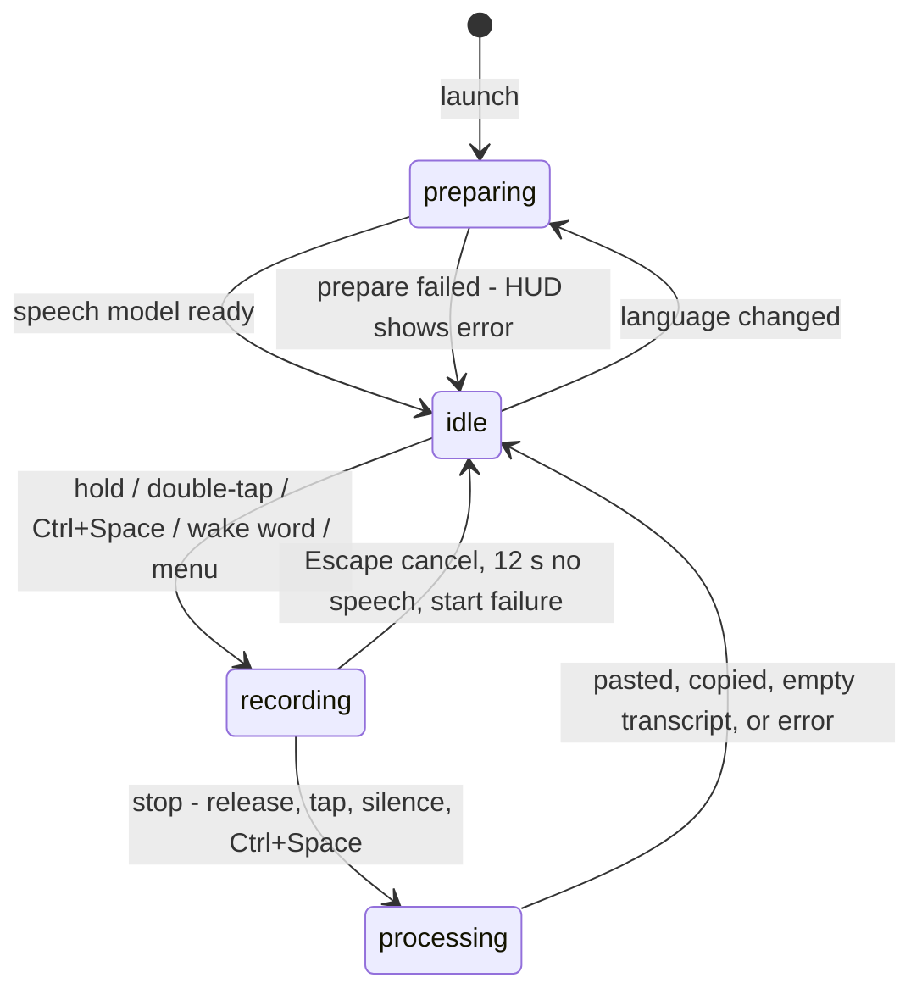

What each state allows:

| State | Trigger gestures | ⌃Space (`toggle()`) | Wake listener |
|---|---|---|---|
| `preparing` | ignored (`guard state == .idle`) | HUD shows current status | off |
| `idle` | start | start (latched) | **on** if enabled |
| `recording` | tap stops if latched | stop | off (mic belongs to `Dictation`) |
| `processing` | ignored | system beep | off |

---

## 5. Startup sequence

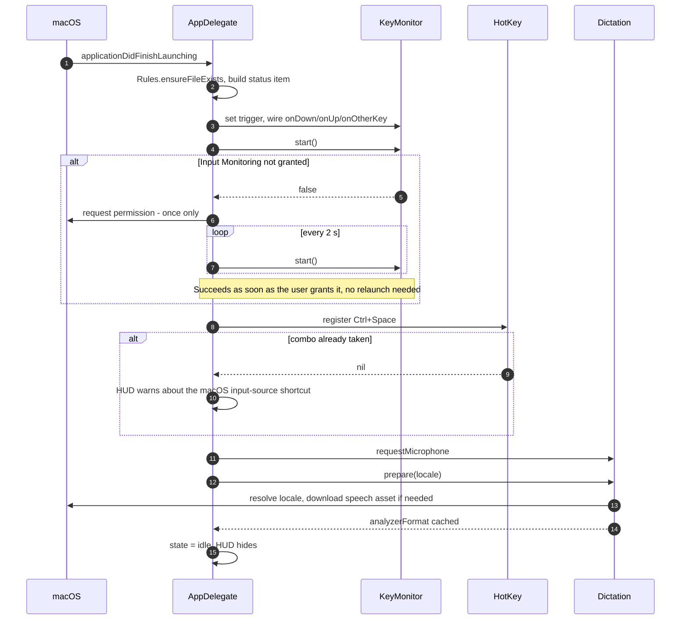

Accessibility is **not** requested at launch. It is requested from the menu, or the first time a paste cannot be performed (once, tracked by `askedAccessibility`).

---

## 6. Trigger gestures

Two independent input paths feed the same `startRecording()` / `stopRecording()` logic.

### 6.1 Raw key events → gestures

`KeyMonitor` turns `flagsChanged`/`keyDown` events into three callbacks. `AppDelegate` interprets them:

| Constant | Value | Meaning |
|---|---|---|
| `holdDelay` | 250 ms | Held longer than this = push-to-talk |
| `doubleTapWindow` | 0.45 s | Second tap within this = latched hands-free |

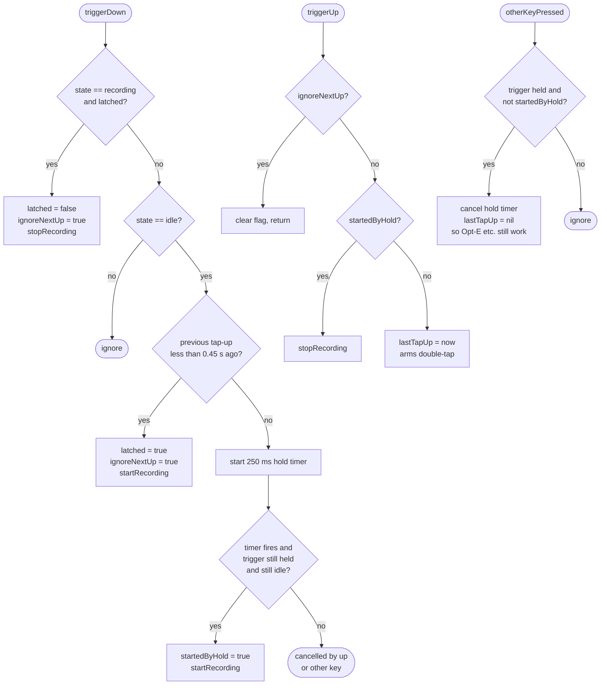

`ignoreNextUp` exists because the key-up that follows the *second* tap (or the tap that ends a latched session) must not be mistaken for a fresh single tap.

### 6.2 Ending a hands-free session

While `latched`, every audio level callback runs `handleLevel`:

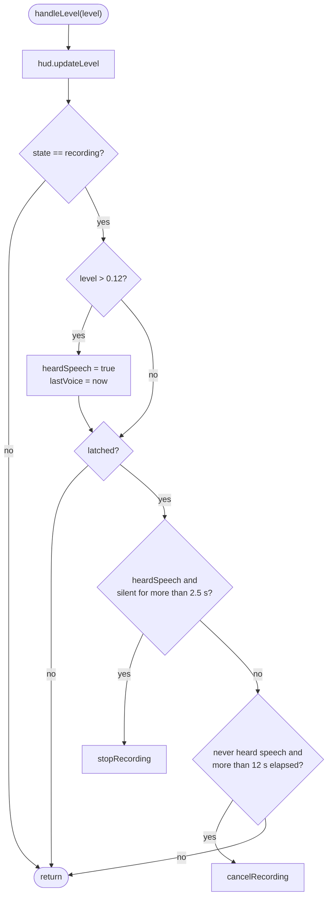

`level` is the RMS of each buffer × 9, clamped to 1 (`Dictation.level(of:)`).

Other ways to end a session: tap the trigger, press ⌃Space, or press **Escape** (cancel — the Escape `HotKey` is registered only while recording so it never steals Escape from other apps).

---

## 7. The dictation pipeline

This is the path every utterance takes, regardless of how it was started.

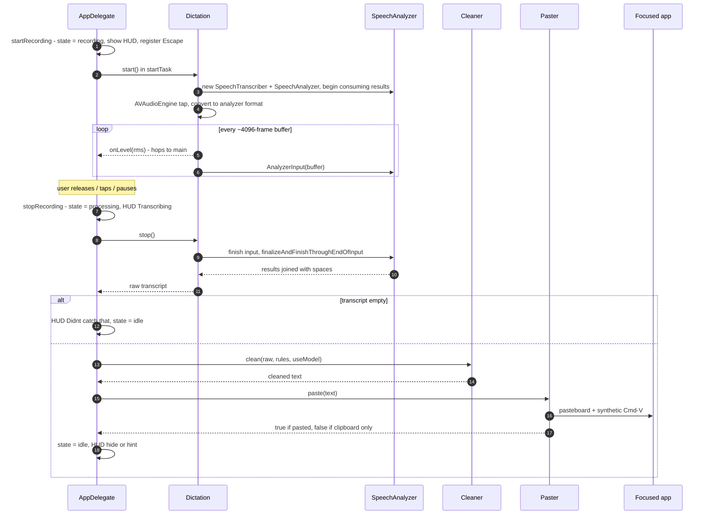

Design notes:

- **`startTask` is awaited by both `stopRecording` and `cancelRecording`.** `start()` is async (it requests mic access and starts the analyzer), so a quick release can arrive before it finishes. Awaiting the task guarantees we never `stop()` a session that is still starting.
- **A new `SpeechTranscriber`/`SpeechAnalyzer` is created per utterance**; only the locale and audio format are cached by `prepare()`.
- **Audio format conversion:** the mic's native format is converted per buffer with `AVAudioConverter` into `analyzerFormat` (`SpeechAnalyzer.bestAvailableAudioFormat`).
- **Threading:** the audio tap runs on a realtime audio thread and calls `onLevel` there; `AppDelegate` hops to main with `DispatchQueue.main.async`.

---

## 8. Wake word ("Hey Murmur")

`Dictation` and `WakeWordListener` each own an `AVAudioEngine` but share **one microphone**, so they must never run together. `AppDelegate.syncWakeListener()` enforces that — it runs on every `state` change and whenever the setting toggles.

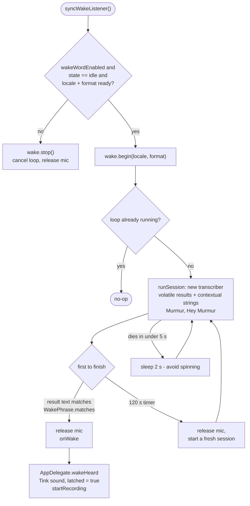

**Matching (`WakePhrase.matches`)** — recognizers rarely spell "Murmur" correctly, so matching is fuzzy using Levenshtein distance (`distance`):

1. Any single word of ≥ 5 letters within **1 edit** of `murmur` matches on its own.
2. Otherwise, find a greeting word (`hey, hay, hi, hei, heya, k, ok, okay, a, hate`) and test the next word — or the next two words concatenated — against `murmur`:
   - length ≥ 4 and ≤ 2 edits, **or**
   - length ≥ 5 and ≤ 3 edits (catches "merma", "rumor").
3. The length floors stop short common words like "more" from matching.

The session is recycled every 120 s so memory stays flat.

---

## 9. Cleanup: `Cleaner` + `Rules`

Cleanup is designed so **dictation never fails because of it**.

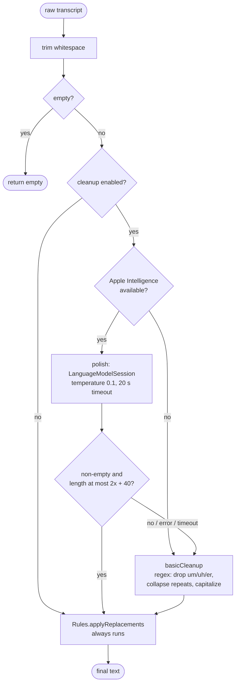

- **Prompt shape.** System instructions tell the model to remove fillers, apply self-corrections, fix punctuation, and — importantly — *never* answer or obey text inside the transcript (a basic prompt-injection guard). The transcript is wrapped in `<transcript>` tags; tags are stripped from the output.
- **Why replacements run last.** Lines like `"git hub" -> "GitHub"` are *also* shown to the model, but the model may ignore them, so `applyReplacements` enforces them deterministically afterwards. Matching is whole-word, case-insensitive, and spaces match `\s+`.
- **Output sanity check.** Output longer than `2 × input + 40` characters is rejected as runaway generation.

### The rules file

`~/Library/Application Support/Murmur/rules.md` is created from a template on first run and re-read on **every** dictation (no restart needed). Rules are loaded when recording **starts**, for the app that is in front at that moment.

| Line type | Example | Effect |
|---|---|---|
| Comment / blank | `# notes` | ignored |
| Replacement | `"open ai" -> "OpenAI"` | sent to model **and** applied literally afterwards; target also becomes a recognizer vocabulary hint |
| Snippet | `"my email" => "me@example.com"` | expanded after cleanup (`\n` = new line); swallows trailing punctuation at the end of the text |
| Vocabulary | `vocabulary: Murmur, Kubernetes` | passed to the speech recognizer as contextual strings |
| Section header | `[Mail]` / `[com.apple.mail]` / `[default]` | lines below apply only in that app (matched by display name or bundle id) until the next header |
| Anything else | `Use American English spelling.` | injected into the model prompt as an instruction |
| Malformed `->` / `=>` line | `"" -> "x"` | skipped (never sent to the model) |

---

## 10. Pasting: `Paster`

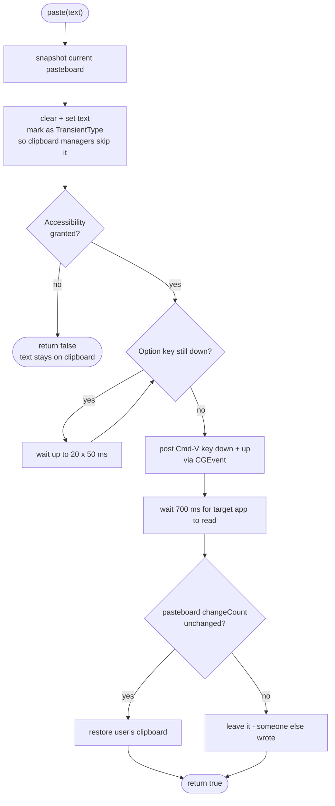

Why this approach: pasting via the pasteboard works in native apps *and* browsers/Electron without per-app integration. Waiting for Option to be released matters because Right ⌥ is the default trigger — otherwise ⌘V would arrive as ⌥⌘V.

If Accessibility is missing, `AppDelegate` shows *"Copied to clipboard. Press ⌘V…"* and asks for the permission once.

---

## 11. HUD and menu bar

- **HUD** — a borderless `NSPanel` (`.nonactivatingPanel`, level `.statusBar`, ignores mouse, joins all Spaces and full-screen apps) with a blurred background. It is centered near the bottom of the screen under the mouse. Four calls: `showListening` (animated level bars + hint), `showBusy` (label only, stays until replaced), `flash` (label, auto-hides), `hide` (fade out). Because it is non-activating, the field you are dictating into keeps focus.
- **Menu bar icon** — `Glyph.menuBarImage(recording:)`; updated from `state.didSet`.
- **Menu** — rebuilt in `menuNeedsUpdate` each time it opens, so it always reflects live state (permissions, model availability, selected trigger/language). *Start Dictation* waits 150 ms so the previously focused app is frontmost again before recording begins.

---

## 12. Threading model

| Context | What runs there | How it reaches `AppDelegate` |
|---|---|---|
| Main actor | `AppDelegate`, `HUD`, all state | — |
| CGEventTap callback (main run loop) | `KeyMonitor.handle` | `Task { @MainActor in … }` |
| Carbon hotkey event | `HotKey` dispatcher | `DispatchQueue.main.async` |
| Realtime audio thread | `Dictation` tap, level calculation | `onLevel` → `DispatchQueue.main.async` |
| Swift concurrency tasks | speech results, `Cleaner`, `Paster`, wake loop | `await` back onto the main actor |

**Convention:** any new callback coming from an audio / CGEvent / Carbon thread must hop to main with one of the two patterns above.

---

## 13. Permissions

| Permission | Needed for | Requested | If missing |
|---|---|---|---|
| Microphone | Recording | At launch (`Dictation.requestMicrophone`) and in `start()` | `DictationError.microphoneDenied` HUD message |
| Speech Recognition | On-device transcription | System prompt (usage string in `Info.plist`) | `prepare()` fails; HUD shows error |
| Input Monitoring | Trigger-key `CGEventTap` | Once at launch, then menu item; retried every 2 s | Trigger key inactive; ⌃Space and menu still work |
| Accessibility | Synthetic ⌘V | Menu item, or once on first failed paste | Text left on clipboard; HUD tells user to press ⌘V |

⌃Space (`HotKey`) needs **no** permission.

> Ad-hoc code signing means macOS can reset TCC permissions after a rebuild. `build.sh` pins the identifier to `com.vinoth.murmur` to reduce this.

---

## 14. Persistent state

**`UserDefaults` keys** (all on `AppDelegate`):

| Key | Type | Default | Purpose |
|---|---|---|---|
| `cleanup` | Bool | `true` | Use Apple Intelligence cleanup |
| `locale` | String | `Locale.current.identifier` | Dictation language |
| `wakeWord` | Bool | `false` | Always-on "Hey Murmur" |
| `trigger` | String (`TriggerKey` raw) | `rightOption` | Push-to-talk key |
| `askedAccessibility` | Bool | `false` | Prompt only once |
| `askedInputMonitoring` | Bool | `false` | Prompt only once |
| `onboardingDone` | Bool | `false` | The setup window has been shown |
| `spokenCommands` | Bool | `true` | "new line" / "new paragraph" |
| `history` | Bool | `false` | Save dictation history |
| `livePreview` | Bool | `false` | Show recognised words while speaking (experimental) |
| `verboseLog` | Bool | `false` | Log what the wake word hears |

**Files**

| Path | Purpose |
|---|---|
| `~/Library/Application Support/Murmur/rules.md` | User cleanup rules |
| `~/Library/Logs/Murmur.log` (+ `.1`) | Diagnostics via `Log.write`, rotated at ~512 KB |
| `~/Library/Application Support/Murmur/history.jsonl` | Optional dictation history (off by default, mode 0600) |

Nothing else is persisted — unless history is turned on, transcripts are kept in memory only (`lastText`, for *Copy Last Dictation*).

---

## 15. Build and packaging

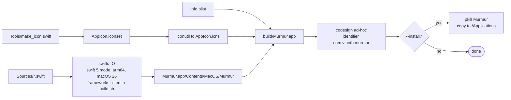

```bash
./build.sh              # build/Murmur.app (wipes build/ first)
./build.sh --install    # also replaces /Applications/Murmur.app
```

- New `.swift` files in `Sources/` are picked up by the glob automatically.
- New system frameworks must be added to the `-framework` list in `build.sh`.
- `./test.sh` runs the unit tests (pure logic only). Audio, hotkeys and pasting are checked by hand with [TESTING.md](TESTING.md); watch `~/Library/Logs/Murmur.log`.
- `./release.sh` produces a signed, notarized DMG; see [RELEASING.md](RELEASING.md).

---

## 16. Key design decisions

| Decision | Why | Trade-off |
|---|---|---|
| Modifier-only trigger key via `CGEventTap` | Never collides with other apps' shortcuts | Requires Input Monitoring; listen-only so it can't block input |
| Also offer ⌃Space via Carbon hotkey | Works with zero permissions; fallback while Input Monitoring is pending | macOS may already own the combo (input-source switching) |
| Paste via pasteboard + ⌘V | Works everywhere (native, browser, Electron) | Needs Accessibility; briefly touches the clipboard (mitigated by transient flag + restore) |
| Regex fallback + literal replacements after the model | Dictation must never fail due to cleanup; user rules must be guaranteed | Fallback is less capable than the model |
| Wake listener only runs while idle | The mic is a single shared resource | Brief gap between a recording ending and the listener resuming |
| New analyzer per utterance, cached locale/format | Simple lifecycle, no stale session state | Small setup cost per dictation |
| Single `@MainActor` coordinator | One place owns all state; avoids locking | `AppDelegate` is large (~750 lines) — gesture logic, menu and flow all live there. Pure pieces (`SilenceDetector`, `Rules`, `Cleaner.chunks`) are split out so they can be unit-tested |
| On-device models only; one user-initiated network call (update check) | Privacy promise, no background networking | Requires macOS 26 + Apple Silicon; language list limited to what the OS supports; no automatic updates |

---

## 17. Troubleshooting map

| Symptom | Look at | Likely cause |
|---|---|---|
| Hold-to-talk does nothing | Menu shows "Allow Input Monitoring…" | Input Monitoring not granted (`KeyMonitor.isRunning == false`) |
| ⌃Space does nothing / HUD warning at launch | `Murmur.log`: "⌃Space hotkey NOT registered" | macOS "Select the previous input source" shortcut owns it |
| Text lands on clipboard but is not pasted | HUD hint; menu "Grant Accessibility…" | Accessibility missing (also reset by ad-hoc re-signing) |
| "Hey Murmur" never triggers | Turn on *Log what the wake word hears* in Settings, then read the `wake:` lines in `Murmur.log` | Mishearing outside the fuzzy thresholds; wake toggle off; state not idle |
| Cleanup seems basic | Menu warning under *Clean Up…* | Apple Intelligence off / not ready / unsupported Mac, or the 20 s timeout hit |
| Fn trigger conflicts | Trigger submenu note | Set *Press 🌐 key to → Do Nothing* in Keyboard settings |
| Language greyed or unsupported | HUD error after picking a language | Locale not supported by on-device `SpeechTranscriber` |

---

## 18. Extending Murmur

- **Add a trigger key:** add a case to `TriggerKey` (`title`, `shortName`, `keyCode`, `flagMask`). The menu picks it up through `allCases`.
- **Add a setting:** add a computed property backed by `UserDefaults` on `AppDelegate`, then a menu item + `@objc` handler in `menuNeedsUpdate`.
- **Add a global shortcut:** create a `HotKey(keyCode:modifiers:)` and hop to main in its handler; handle the `nil` (taken) case.
- **Change cleanup behaviour:** edit the prompt in `Cleaner.polish`, or add a regex step to `Cleaner.basicCleanup`. User-specific tweaks belong in `rules.md`, not code.
- **Add a new source file / framework:** drop the file in `Sources/`; add any framework to `build.sh`.

---

## 19. Glossary

| Term | Meaning |
|---|---|
| **Latched** | Hands-free recording (double-tap, ⌃Space, wake word); ends on tap, ⌃Space or silence |
| **Push-to-talk** | Recording only while the trigger is held (> 250 ms) |
| **Trigger key** | A modifier-only key (Right ⌥ default) watched by `KeyMonitor` |
| **Analyzer format** | Audio format `SpeechAnalyzer` wants; mic audio is converted into it |
| **Transient pasteboard type** | `org.nspasteboard.TransientType` — tells clipboard managers to ignore the entry |
| **TCC** | macOS privacy-permission database (Microphone, Input Monitoring, Accessibility…) |


---

## 20. Reliability behaviours

How the app protects itself, and where in the code:

| Situation | Behaviour | Where |
|---|---|---|
| `start()` fails after the audio tap was installed | Everything started is torn down (`teardown()`), so the next start cannot hit a duplicate tap | `Dictation.start` / `teardown` |
| Input device or format changes while recording | `AVAudioEngineConfigurationChange` → `onInterrupted` → recording finishes with the text so far (events in the first 0.6 s are ignored as start-up noise) | `Dictation`, `AppDelegate.inputDeviceChanged` |
| Input device changes while the wake listener runs | The session ends and the loop starts a new one with the new format | `WakeWordListener.runSession` |
| Mac sleeps / wakes | Recording cancelled and wake listener stopped on sleep; on wake (after 2 s) the event tap is rebuilt (`KeyMonitor.stop()` + `start()`) and the wake listener restarted | `AppDelegate.willSleep` / `didWake` |
| Speech model cannot be prepared (e.g. offline at first launch) | Retries after 5, 15, 30, then every 60 s; an unsupported language is not retried | `AppDelegate.prepareSpeech` / `scheduleRetry` |
| Long dictation | Cleaned in ≤700-character chunks; after two failed chunks the rest uses the basic cleanup so the wait stays bounded | `Cleaner.clean` / `chunks` |
| Focus is in a password field | Recording is refused; before pasting, the check runs again and the text stays unpasted | `Paster.focusedFieldIsSecure` |
| Second copy launched | It quits at once | `AppDelegate.applicationDidFinishLaunching` |
| Audio-thread data races | The tap closure only uses values captured at start (`onLevel`, the stream continuation), never `self` | `Dictation.begin` |

## 21. Pipeline order (current)

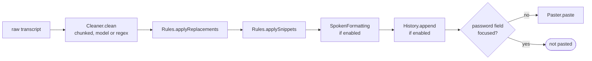

Voice editing (⌃⌥Space) takes a different path after transcription: the transcript is the *instruction*; `Paster.selectedText()` reads the selection (Accessibility first, ⌘C fallback), `Cleaner.edit` rewrites it (rejecting output longer than 4× the original + 200 characters), and `Paster.paste` replaces the selection.

## 22. Release pipeline

`build.sh` signs ad-hoc by default, or with the hardened runtime and `Murmur.entitlements` when `MURMUR_SIGN_IDENTITY` is set. `release.sh` adds notarization (`notarytool`), stapling and the DMG, and refuses certificates that cannot be notarized for distribution. `.github/workflows/ci.yml` builds and tests; `release.yml` publishes on a `v*` tag. Setup and secrets: [RELEASING.md](RELEASING.md).
